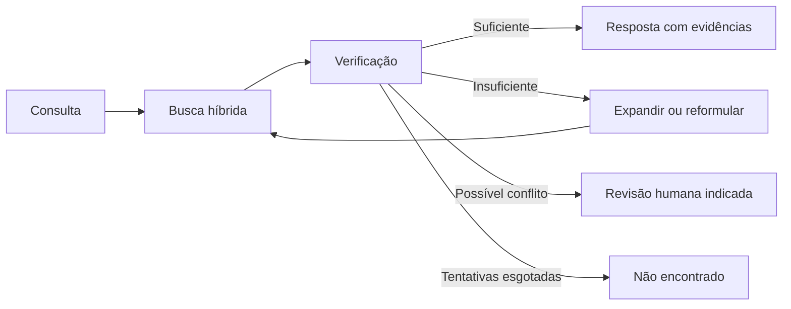

# Low-Ship

**Respostas fundamentadas em documentos, com busca híbrida e verificação de evidências.**

O Low-Ship é uma aplicação de **RAG (Retrieval-Augmented Generation)** que permite consultar regras de um manual de operações marítimas em linguagem natural. O objetivo é demonstrar como transformar documentos extensos em respostas rastreáveis, sem tratar um trecho apenas relacionado ao assunto como prova suficiente para responder.

Em vez de buscar e responder uma única vez, o sistema recupera evidências, avalia se elas sustentam a pergunta e adapta a consulta quando falta contexto.

## O problema que resolve

Manuais operacionais concentram regras, exceções e procedimentos em diferentes seções. Uma pesquisa por palavras-chave pode deixar de encontrar a informação certa; por outro lado, uma resposta gerada sem evidências pode transmitir uma regra inexistente.

O Low-Ship foi construído para explorar uma alternativa mais controlada: **recuperar, verificar e só então responder**.

## O que a aplicação demonstra

| Capacidade | Como funciona |
|---|---|
| **Busca híbrida** | Combina embeddings e BM25, unindo proximidade semântica e correspondência de termos |
| **Ranking de evidências** | Usa Reciprocal Rank Fusion (RRF) para combinar os dois mecanismos de busca |
| **Avaliação de contexto** | Um nó com saída estruturada classifica o contexto como suficiente, insuficiente ou possivelmente conflitante |
| **Recuperação adaptativa** | Expande seções vizinhas ou reformula a consulta quando faltam informações, com limite de duas buscas |
| **Rastreabilidade** | Exibe seções recuperadas, trechos de contexto, consulta utilizada e número de buscas |
| **Resposta segura diante da ausência de dados** | Informa quando o manual não sustenta uma resposta, sem preencher lacunas com suposições |

## Arquitetura



A orquestração é implementada com **LangGraph**, separando entrada, recuperação, verificação, decisão, expansão e geração. A interface Streamlit permite experimentar as consultas e inspecionar o contexto retornado.

## Experimente perguntas como estas

* Qual é a velocidade segura durante uma tempestade na rota direta?
* Qual é a reserva mínima de combustível de um navio?
* Como é calculado o tempo estimado de chegada?
* Qual é a velocidade máxima permitida durante neblina?

A última consulta é um caso de teste de **informação não documentada**: o sistema deve reconhecer a ausência da regra.

## Tecnologias

**Python · LangGraph · LangChain · RAG · Embeddings · BM25 · RRF · Pydantic · NLTK · Streamlit · OpenRouter**

## Executar localmente

Requer Python 3.11 ou superior compatível com as dependências e uma chave válida do OpenRouter.

```bash
git clone https://github.com/isjoaovictor/Frotas_manual.git
cd Frotas_manual
python -m venv .venv
python -m pip install -r requirements.txt
python -m nltk.downloader punkt_tab
```

Crie **`src/.env`** com:

```dotenv
API_KEY=sua_chave_do_openrouter
LLM_MODEL=openai/gpt-4o-mini
```

Inicie a aplicação:

```bash
python -m streamlit run src/app/main.py
```

No Windows, se o terminal não estiver usando o ambiente virtual, substitua `python` por `.\.venv\Scripts\python.exe`.

**[Leia a documentação técnica completa](src/README.md)** para entender o fluxo de cada nó, a combinação BM25 + RRF, a lógica de decisão, os limites e a configuração detalhada.

---

**Escopo do projeto:** protótipo demonstrativo baseado em um manual fictício. Não consulta telemetria em tempo real, não integra sistemas da Vale e não executa comandos de navegação. A verificação por LLM reduz alguns riscos de respostas sem suporte, mas não substitui validação humana ou controles determinísticos em decisões críticas.
