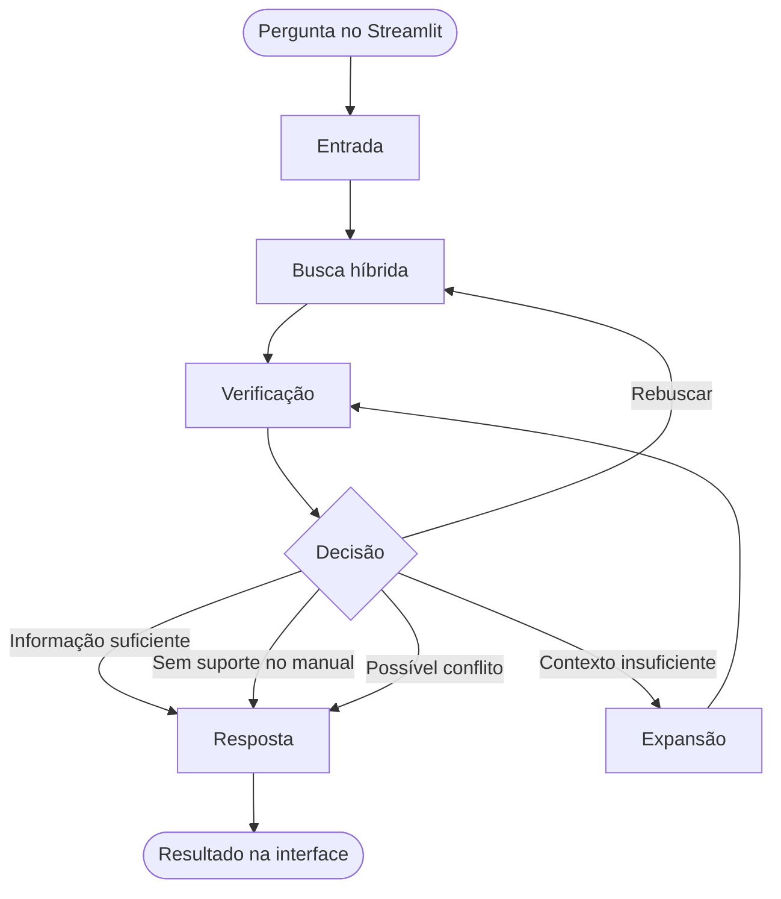

# Low-Ship

**Inteligência documental para operações marítimas.**

O Low-Ship é uma aplicação de consulta a procedimentos operacionais que combina recuperação híbrida de informações, análise de evidências e orquestração condicional com LangGraph. A interface Streamlit permite consultar o manual de operações do Porto Alfa, acompanhar a resposta e inspecionar as fontes e os detalhes da recuperação.

O sistema utiliza o conteúdo do manual como base para responder. Quando a informação não está disponível, retorna essa limitação em vez de estabelecer regras não documentadas.

## 20 perguntas para explorar o Low-Ship

Copie uma das perguntas abaixo na interface para conhecer as diferentes regras cobertas pelo manual.

1. Quais navios compõem a frota e quais são seus nomes?
2. Qual é a capacidade do tanque de combustível do S2-MARE?
3. Quais opções de rota estão disponíveis para os navios?
4. Qual é a distância da rota direta do S1-FAROL?
5. Qual é a distância da rota protegida do S4-ATLAS?
6. Qual é o intervalo permitido para a velocidade-alvo dos navios?
7. Quanto a velocidade efetiva pode variar em um único tick?
8. Quantos minutos simulados equivalem a um tick?
9. Como é calculado o tempo estimado de chegada (ETA) em horas e em ticks?
10. Qual é a velocidade segura durante uma tempestade na rota direta?
11. Qual é a velocidade segura durante uma tempestade na rota protegida?
12. Qual é o percentual mínimo de reserva de combustível de um navio?
13. Qual é a reserva mínima de combustível do S3-CORAL em toneladas?
14. Qual é o lote mínimo para comprar combustível e quais múltiplos são aceitos?
15. Em quais locais é permitido abastecer um navio?
16. Qual é o preço do combustível no Porto Alfa entre os ticks 36 e 71?
17. Quanto custa e quanto tempo dura o reparo de uma falha no motor do S4-ATLAS?
18. Quanto tempo dura a descarga e qual é o prazo de entrega do S3-CORAL?
19. Quem pode emitir comandos aos navios e quais ações os humanos podem solicitar?
20. Qual é a velocidade máxima permitida durante neblina?

> A última pergunta explora uma situação sem limite específico descrito no manual. Nesses casos, a resposta esperada é **“Não encontrado no manual de operações.”**, após a análise do contexto disponível.

## Visão geral

A consulta começa na interface web e percorre um grafo de processamento que recupera documentos, verifica a suficiência das informações e define se pode responder ou se precisa ampliar a investigação.

O Low-Ship oferece:

* **Busca híbrida:** combina similaridade semântica com busca lexical BM25.
* **Fusão RRF:** consolida os rankings sem depender de pontuações de escalas diferentes.
* **Expansão de contexto:** recupera seções vizinhas do manual quando a informação inicial não é suficiente.
* **Verificação por LLM:** avalia a suficiência e a consistência das informações recuperadas.
* **Rebusca automática:** reformula a consulta quando necessário, respeitando o máximo de duas buscas por pergunta.
* **Respostas fundamentadas:** usa o contexto recuperado e informa quando não encontra suporte documental.
* **Rastreabilidade:** apresenta as fontes disponíveis, os trechos recuperados, a consulta final e a quantidade de buscas.
* **Interface responsiva:** identidade visual Low-Ship, modal de processamento e apresentação das evidências.

### Fluxo de execução



Na segunda passagem por **Busca híbrida**, a função `busca()` reformula a consulta antes de repetir a recuperação. O nó de **Decisão** controla o número máximo de tentativas. Se a verificação apontar conflito, a resposta sinaliza a necessidade de revisão humana; não existe um sistema de aprovação externa nessa etapa.

## Instalação e execução

O Low-Ship pode ser executado localmente em **Windows, Linux ou macOS**, desde que a máquina tenha Python, acesso às dependências e conectividade com o provedor dos modelos.

### Pré-requisitos

* Python 3.11 ou superior, preferencialmente 3.11, 3.12 ou 3.13.
* Código completo do repositório, incluindo `src/dados/manual_operacoes.txt` e `requirements.txt`.
* Uma chave válida do [OpenRouter](https://openrouter.ai/) com acesso aos modelos configurados e créditos ou limite de uso disponível.
* Conexão com a internet para instalar as dependências, baixar os dados de tokenização e acessar os modelos.

Os comandos abaixo devem ser executados **na raiz do projeto**, no diretório em que está o arquivo `requirements.txt`.

### Windows com PowerShell

**1. Crie o ambiente virtual:**

```powershell
py -m venv .venv
```

**2. Ative o ambiente:**

```powershell
.\.venv\Scripts\Activate.ps1
```

**3. Instale as dependências e o recurso de tokenização em português:**

```powershell
python -m pip install -r requirements.txt
python -m nltk.downloader punkt_tab
```

Caso a política do PowerShell impeça a ativação, não é necessário alterar a política de segurança da máquina. Utilize diretamente o Python do ambiente virtual:

```powershell
.\.venv\Scripts\python.exe -m pip install -r requirements.txt
.\.venv\Scripts\python.exe -m nltk.downloader punkt_tab
```

### Linux e macOS

**1. Crie e ative o ambiente virtual:**

```bash
python3 -m venv .venv
source .venv/bin/activate
```

**2. Instale as dependências e os dados do NLTK:**

```bash
python -m pip install -r requirements.txt
python -m nltk.downloader punkt_tab
```

Em algumas distribuições Linux, pode ser necessário instalar o suporte do sistema operacional ao `venv` antes de criar o ambiente. No macOS, instale o Python 3 separadamente caso não esteja disponível.

### Configuração do OpenRouter

Crie um arquivo chamado `.env` **na raiz do projeto**:

```dotenv
API_KEY=sua_chave_do_openrouter
LLM_MODEL=openai/gpt-4o-mini
```

| Variável | Finalidade |
|---|---|
| `API_KEY` | Credencial utilizada nas chamadas de embeddings e geração de texto via OpenRouter. |
| `LLM_MODEL` | Modelo de linguagem utilizado para verificação, reformulação e geração da resposta. Se omitido, o código utiliza `openai/gpt-4o-mini`. |

O modelo de embeddings configurado no código é `openai/text-embedding-3-small`, acessado pelo endpoint compatível do OpenRouter. O arquivo `.env` contém um segredo e **não deve ser versionado nem compartilhado**. Em um computador corporativo, utilize uma chave cuja utilização seja autorizada pela organização.

### Iniciar a interface

Com o ambiente virtual ativado, em qualquer sistema operacional:

```bash
python -m streamlit run src/app/main.py
```

No Windows, também é possível executar sem ativar o ambiente:

```powershell
.\.venv\Scripts\python.exe -m streamlit run src/app/main.py
```

No Linux e macOS, a opção equivalente é:

```bash
./.venv/bin/python -m streamlit run src/app/main.py
```

O servidor local normalmente disponibiliza a interface em **http://localhost:8501** e pode abrir o navegador automaticamente. Para encerrar a aplicação, pressione `Ctrl + C` no terminal.

### Usando a aplicação

1. Abra a interface Low-Ship no navegador.
2. Insira uma pergunta sobre as operações marítimas.
3. Selecione **Consultar manual**.
4. Leia a resposta e consulte a seção **Evidências** para conferir os trechos disponibilizados.
5. Abra **Detalhes da busca** para visualizar a quantidade de buscas, a consulta final e a indicação de expansão do contexto.

Cada envio inicia uma execução do grafo. Abrir as evidências ou os detalhes de uma resposta não precisa disparar uma nova consulta.

## Arquitetura

```text
Frotas_manual/
├── .streamlit/
│   └── config.toml
├── .env
├── requirements.txt
├── README.md
└── src/
    ├── app/
    │   ├── main.py
    │   ├── style.css
    │   └── ship.svg
    ├── dados/
    │   └── manual_operacoes.txt
    ├── graph/
    │   ├── builder.py
    │   ├── state.py
    │   └── node/
    │       ├── entrada.py
    │       ├── busca.py
    │       ├── verificacao.py
    │       ├── decisao.py
    │       ├── expansao.py
    │       └── resposta.py
    └── utils/
        ├── vector_store.py
        └── design.md
```

| Componente | Responsabilidade |
|---|---|
| `src/app/main.py` | Ponto de entrada Streamlit, captura de perguntas, execução do grafo e exibição de resultados. |
| `src/app/style.css` | Identidade visual, responsividade e apresentação do carregamento. |
| `src/app/ship.svg` | Identidade gráfica do cargueiro. |
| `.streamlit/config.toml` | Configuração visual do Streamlit. |
| `src/graph/builder.py` | Registro dos nós, arestas condicionais e compilação do `graph`. |
| `src/graph/state.py` | Contrato do estado compartilhado durante a execução. |
| `src/graph/node/` | Implementações de entrada, recuperação, verificação, decisão, expansão e resposta. |
| `src/utils/vector_store.py` | Preparação de documentos, embeddings, BM25, fusão RRF e expansão por vizinhança. |
| `src/dados/manual_operacoes.txt` | Base documental consultada pelo RAG. |
| `src/utils/design.md` | Especificação visual e comportamental da interface. |

A interface chama o backend por meio de uma única operação:

```python
graph.invoke({"pergunta": pergunta})
```

O `main.py` não executa diretamente o BM25, não calcula o RRF e não contém regras de decisão. Essas operações pertencem ao backend organizado em `src/graph/` e `src/utils/`.

## Recuperação e geração de respostas

### Preparação do manual

O conteúdo do manual é separado pelos títulos `##`. Cada seção é armazenada como um objeto `Document`, com texto e metadados:

| Metadado | Significado |
|---|---|
| `secao` | Título original da seção. |
| `doc` | Identificação do documento de origem. |
| `posicao` | Ordem da seção no documento, utilizada para buscar seus vizinhos. |

### Busca híbrida

A busca combina duas abordagens complementares:

1. **Semântica:** `OpenAIEmbeddings` transforma os textos e a pergunta em vetores, recuperados com `InMemoryVectorStore`.
2. **Lexical:** BM25 classifica as seções pela presença e relevância dos termos, com tokenização em português pelo NLTK.

Os dois rankings são combinados por **Reciprocal Rank Fusion (RRF)**, que considera a posição dos documentos em cada busca. Isso evita tratar diretamente as pontuações vetoriais e lexicais como se estivessem na mesma escala. A identificação conjunta de `doc` e `posicao` evita duplicar um mesmo trecho no ranking final.

### Verificação, expansão e rebusca

A verificação avalia se o contexto sustenta a pergunta e classifica a evidência como `suficiente`, `insuficiente` ou `conflito`.

Quando o contexto é insuficiente, o fluxo pode recuperar as seções imediatamente vizinhas de cada candidato. Persistindo a insuficiência, o sistema pode reformular a consulta e realizar uma segunda recuperação. **O limite é de duas buscas por pergunta**, controlado no estado do grafo.

As respostas são geradas com o conteúdo documental disponível para a execução. Quando não houver suporte suficiente, o fluxo informa que o dado não foi encontrado. Em caso de possível conflito, sinaliza necessidade de revisão humana, sem executar uma aprovação automática.

### Fontes e rastreabilidade

O estado final disponibiliza a resposta, os documentos recuperados, as seções disponíveis, a quantidade de buscas e a última consulta utilizada.

**Importante:** as seções e os trechos retornados pelo backend representam o material recuperado e disponibilizado ao modelo. O sistema não identifica individualmente quais trechos fundamentaram cada afirmação gerada. A interface preserva essa distinção e não apresenta todos os documentos recuperados como citações comprovadas.

## Tecnologias

| Tecnologia | Aplicação |
|---|---|
| Python | Implementação do processamento e da interface. |
| Streamlit | Aplicação web e gerenciamento de sessão. |
| LangGraph | Orquestração condicional dos nós do RAG. |
| LangChain | Objetos de documento, modelo, embeddings e armazenamento vetorial. |
| OpenRouter | Acesso aos modelos de linguagem e embeddings. |
| BM25 (`rank-bm25`) | Recuperação lexical. |
| NLTK | Tokenização em português. |
| Pydantic | Validação da avaliação estruturada do contexto. |
| NumPy | Operações numéricas da recuperação vetorial em memória. |

## Observações operacionais

**Fonte de conhecimento.** O resultado depende do conteúdo disponível em `manual_operacoes.txt`. A aplicação não consulta automaticamente outros manuais, sistemas corporativos ou informações operacionais em tempo real.

**Persistência.** O armazenamento vetorial é feito em memória. Uma nova inicialização do processo pode exigir a reconstrução do índice e novas chamadas ao serviço de embeddings.

**Custos e conectividade.** A execução depende do provedor configurado e pode gerar consumo de créditos de API. Mensagens de erro `402` normalmente indicam limite financeiro ou de tokens insuficiente para a solicitação.

**NLTK.** Caso apareça `Resource punkt_tab not found`, execute novamente `python -m nltk.downloader punkt_tab` no ambiente Python utilizado pela aplicação.

**Segurança.** Nunca inclua chaves reais em código, imagens, logs publicados ou commits. Se alguma chave for exposta, revogue-a no provedor antes de configurar outra.

## Documentação técnica

* [Streamlit: instalação e execução](https://docs.streamlit.io/get-started/installation/command-line)
* [LangGraph: documentação oficial](https://docs.langchain.com/oss/python/langgraph/overview)
* [LangChain: integrações e documentação Python](https://docs.langchain.com/oss/python/langchain/overview)
* [NLTK: instalação de dados](https://www.nltk.org/data.html)
* [OpenRouter: documentação](https://openrouter.ai/docs)
