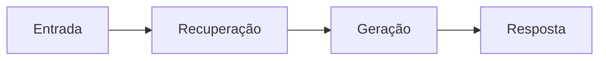
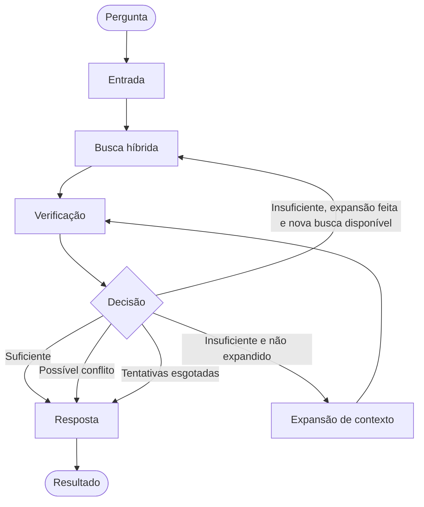

# Low-Ship

**RAG com recuperação híbrida, avaliação de evidências e orquestração condicional para consultas a operações marítimas.**

O **Low-Ship** transforma um manual operacional em uma base de conhecimento consultável por linguagem natural. Em vez de encaminhar diretamente os primeiros documentos encontrados a um modelo de linguagem, a aplicação combina métodos de recuperação, verifica a suficiência do contexto e adapta o percurso da consulta quando necessário.

A resposta é fundamentada no conteúdo disponível no **Manual de Operações do Porto Alfa**, com identificação das seções consultadas e informações sobre o processo de recuperação. Quando o manual não sustenta uma resposta, o sistema informa essa limitação.

## 20 perguntas para explorar o Low-Ship

1. Quais navios compõem a frota e quais são seus nomes?
2. Qual é a capacidade do tanque de combustível do S2-MARE?
3. Quais opções de rota estão disponíveis para os navios?
4. Qual é a distância da rota direta do S1-FAROL?
5. Qual é a distância da rota protegida do S4-ATLAS?
6. Qual é o intervalo permitido para a velocidade-alvo dos navios?
7. Quanto a velocidade efetiva pode variar em um único tick?
8. Quantos minutos simulados equivalem a um tick?
9. Como é calculado o tempo estimado de chegada (ETA) em horas e em ticks?
10. Qual é a velocidade segura durante uma tempestade na rota direta?
11. Qual é a velocidade segura durante uma tempestade na rota protegida?
12. Qual é o percentual mínimo de reserva de combustível de um navio?
13. Qual é a reserva mínima de combustível do S3-CORAL em toneladas?
14. Qual é o lote mínimo para comprar combustível e quais múltiplos são aceitos?
15. Em quais locais é permitido abastecer um navio?
16. Qual é o preço do combustível no Porto Alfa entre os ticks 36 e 71?
17. Quanto custa e quanto tempo dura o reparo de uma falha no motor do S4-ATLAS?
18. Quanto tempo dura a descarga e qual é o prazo de entrega do S3-CORAL?
19. Quem pode emitir comandos aos navios e quais ações os humanos podem solicitar?
20. Qual é a velocidade máxima permitida durante neblina?

A pergunta 20 explora um tema para o qual o manual não estabelece uma velocidade específica. Ela ilustra uma característica importante do Low-Ship: **a ausência de informação deve ser comunicada, não preenchida com uma regra inventada**.

## 1. Visão do projeto

Um RAG (*Retrieval-Augmented Generation*, ou geração aumentada por recuperação) consulta documentos antes de produzir uma resposta. Sua qualidade depende tanto do modelo de linguagem quanto da capacidade de localizar o conteúdo correto e identificar quando ele é insuficiente.

O Low-Ship organiza esse processo em três responsabilidades:

1. **Recuperar:** localizar seções relevantes com busca semântica e lexical, combinadas por RRF.
2. **Avaliar:** analisar as evidências disponíveis, identificar lacunas e possíveis conflitos entre regras.
3. **Responder:** produzir uma resposta sustentada pelo manual ou comunicar que não existe suporte documental suficiente.

A orquestração utiliza **LangGraph**, permitindo que o fluxo avance por caminhos diferentes de acordo com o resultado da verificação. O Streamlit disponibiliza a aplicação para consultas no navegador; o processamento permanece independente da interface.

### Objetivos

* Permitir perguntas em linguagem natural sobre regras, limites e procedimentos descritos no manual.
* Combinar recuperação por significado e por correspondência de termos.
* Preservar a localização dos trechos por documento, seção e posição.
* Evitar que o modelo trate documentos apenas relacionados ao assunto como prova suficiente para responder.
* Recuperar contexto adjacente e reformular a consulta quando a primeira recuperação não for suficiente.
* Limitar automaticamente a quantidade de buscas e evitar ciclos indefinidos.
* Diferenciar resposta fundamentada, informação não encontrada e possível conflito documental.

### Escopo

O conhecimento vem do arquivo `src/dados/manual_operacoes.txt`. A aplicação **não** consulta dados reais de frota, sensores, localização de navios ou sistemas corporativos, tampouco emite comandos operacionais. As regras respondidas correspondem exclusivamente ao manual disponibilizado.

O título da interface contextualiza a aplicação no tema de custos de frota, mas **não representa um otimizador de rotas, um simulador de custos ou uma integração operacional com a Vale**.

## 2. Da consulta linear ao fluxo adaptativo

Em um RAG linear, a estrutura usual é:



Nesse modelo, o gerador recebe diretamente os documentos recuperados. Uma recuperação incompleta ou fora de contexto pode produzir uma resposta sem fundamento suficiente.

No Low-Ship, **a recuperação não é o fim da análise**. Antes de gerar a resposta, um nó verifica se o contexto permite responder. Se faltar informação, o sistema pode ampliar os trechos consultados ou reformular a busca, sempre com um limite definido.

| Aspecto | RAG linear | Low-Ship |
|---|---|---|
| Recuperação | Uma busca | Busca semântica e BM25 combinadas por RRF |
| Seleção | Primeiros resultados | Ranking combinado com identificação única por chunk |
| Suficiência | Geralmente presumida | Avaliação explícita por LLM |
| Contexto incompleto | Segue para geração | Tenta expansão por vizinhança |
| Consulta insuficiente | Sem recuperação adicional | Reformula e realiza até uma segunda busca |
| Regras contraditórias | Podem ser confundidas | Classificação de possível conflito e sinalização de revisão |
| Ausência de informação | Risco de resposta especulativa | Encerramento com informação não encontrada |
| Inspeção | Resposta final | Seções, trechos recuperados, consulta final e tentativas |

Essas escolhas reduzem alguns riscos de respostas sem suporte, mas **não tornam a avaliação de um LLM infalível**. Os documentos e a justificativa da verificação continuam importantes para inspeção.

## 3. Fluxo de execução



**O retorno à busca não é uma repetição cega.** Ao entrar pela segunda vez em `busca()`, o nó reformula os termos da consulta antes de executar novamente a recuperação híbrida. A pergunta original é preservada no estado e continua sendo o objetivo da resposta.

A execução admite **no máximo duas buscas** por pergunta. A expansão de contexto é uma etapa diferente: ela amplia o material já recuperado e retorna diretamente à verificação, sem aumentar o contador de buscas.

### Responsabilidade de cada nó

| Nó | Arquivo | O que faz | O que entrega ao próximo nó |
|---|---|---|---|
| **Entrada** | `graph/node/entrada.py` | Normaliza a pergunta e inicializa os campos de execução. | Pergunta, consulta inicial, contadores e coleções vazias. |
| **Busca** | `graph/node/busca.py` | Executa a busca híbrida; na segunda passagem, reformula a consulta com apoio do LLM. | Documentos candidatos, contexto inicial e número de buscas. |
| **Verificação** | `graph/node/verificacao.py` | Avalia se o material disponível responde à pergunta e se há informações incompatíveis para a mesma condição. | Classificação e justificativa da avaliação. |
| **Decisão** | `graph/node/decisao.py` | Considera classificação, histórico de expansão e tentativas para escolher o próximo caminho. | Destino do fluxo. |
| **Expansão** | `graph/node/expansao.py` | Recupera trechos vizinhos aos documentos encontrados, preservando o resultado original da busca. | Contexto expandido e indicador de expansão. |
| **Resposta** | `graph/node/resposta.py` | Produz resposta com LLM ou mensagem de ausência/conflito, conforme a decisão. | Resposta textual e seções disponibilizadas. |

O `builder.py` registra esses nós e define as conexões fixas e condicionais. O `state.py` estabelece quais informações podem circular entre eles.

### Como a decisão funciona

A decisão segue uma ordem explícita:

1. **Conflito:** sinaliza necessidade de revisão humana. É um aviso, não uma aprovação externa implementada.
2. **Suficiente:** permite a geração da resposta.
3. **Insuficiente sem expansão anterior:** solicita os chunks vizinhos.
4. **Insuficiente após expansão, com menos de duas buscas:** retorna ao nó de busca para reformular a consulta.
5. **Insuficiente após esgotar as tentativas:** encerra com `Não encontrado no manual de operações.`

O verificador diferencia regras para **condições distintas** de regras realmente incompatíveis. Por exemplo, velocidades seguras diferentes para rota direta e rota protegida durante tempestade não constituem, por si só, um conflito.

## 4. Recuperação de informação

### 4.1. Preparação dos documentos

O manual é dividido pelos títulos de segundo nível (`##`) utilizando `MarkdownHeaderTextSplitter`. Cada seção se torna um objeto `Document`, contendo o texto e três metadados essenciais:

| Metadado | Exemplo | Utilização |
|---|---|---|
| `doc` | `manual_operacoes` | Identifica o documento de origem. |
| `secao` | `Combustível e reserva` | Permite localizar e apresentar a seção ao usuário. |
| `posicao` | `7` | Preserva a ordem e permite recuperar seções adjacentes. |

Esses metadados também impedem que o mesmo trecho seja considerado um novo documento quando aparece nos dois mecanismos de busca.

### 4.2. Busca semântica

A busca semântica utiliza `OpenAIEmbeddings` com o modelo `openai/text-embedding-3-small`, acessado pelo OpenRouter, e `InMemoryVectorStore` para localizar trechos por proximidade de significado.

Um *embedding* é uma representação numérica do texto. Frases que tratam de conceitos semelhantes podem ocupar regiões próximas desse espaço numérico mesmo quando não utilizam exatamente as mesmas palavras.

Essa busca ajuda a recuperar seções quando a pergunta e o manual usam expressões diferentes para a mesma ideia.

### 4.3. Busca lexical com BM25

A busca lexical utiliza `BM25Okapi`, da biblioteca `rank-bm25`, e tokenização em português com NLTK. O algoritmo atribui pontuações considerando a ocorrência dos termos da pergunta nos documentos e sua relevância relativa no conjunto.

Essa abordagem complementa a busca semântica especialmente quando a consulta contém termos operacionais específicos, siglas, identificadores de navios ou unidades.

### 4.4. Fusão dos rankings com RRF

As pontuações retornadas pelos dois algoritmos não possuem necessariamente a mesma escala. Em vez de somá-las diretamente, o Low-Ship utiliza **Reciprocal Rank Fusion (RRF)**, que trabalha com a posição de cada documento em cada ranking:

\[
RRF(d) = \sum_{r \in \{semântica,\,lexical\}} \frac{1}{60 + posição_r(d)}
\]

Um trecho que aparece bem posicionado nas duas buscas acumula contribuições de ambas. Cada documento é identificado pelo par `(doc, posicao)`, evitando duplicações durante a fusão.

**Exemplo:** se `Combustível e reserva` aparece em primeiro lugar nos dois rankings, recebe duas contribuições de `1/61`, totalizando aproximadamente `0,03279`.

O resultado dessa etapa é uma lista ordenada de documentos, utilizada pelo nó de verificação.

## 5. Avaliação, expansão e rebusca

### Verificação de suficiência

O nó `verificacao()` envia ao LLM a pergunta e os textos recuperados. Sua saída é estruturada com Pydantic e limitada a três classificações:

| Classificação | Significado |
|---|---|
| `suficiente` | O contexto contém informações que permitem responder. |
| `insuficiente` | Falta alguma informação necessária para responder à pergunta. |
| `conflito` | Existem informações aparentemente incompatíveis aplicáveis à mesma condição. |

A classificação acompanha uma justificativa, armazenada em `motivo_avaliacao`. A verificação é baseada no conteúdo disponível, sem acesso automático a outras fontes.

### Expansão por vizinhança

Quando a recuperação inicial é insuficiente, `expansao()` chama `expandir_contexto()`. A função busca chunks **adjacentes na ordem original do documento**, utilizando `(doc, posicao)`.

Por padrão, `raio=1` considera o trecho recuperado, o anterior e o posterior, quando existirem. Se o resultado inclui a posição 7, a expansão pode recuperar as posições 6, 7 e 8.

Essa expansão **não é uma nova busca vetorial**. Seu objetivo é preservar a continuidade de uma regra distribuída por seções vizinhas.

### Reformulação na segunda busca

Persistindo a insuficiência após a expansão, o grafo pode retornar a `busca()`. O nó verifica `tentativas_busca`; se uma busca já foi realizada, solicita ao LLM uma nova formulação com termos relacionados, preservando a intenção original.

Por exemplo, uma pergunta sobre *neblina* pode ser reformulada com *nevoeiro*. A nova consulta passa novamente pela combinação semântica e lexical. O processo termina ao encontrar suporte documental ou atingir o limite de duas buscas.

O sistema não adiciona informações externas à pergunta para justificar uma resposta. A reformulação afeta os termos da recuperação, não a regra de negócio nem o conteúdo do manual.

## 6. Estado, rastreabilidade e limites

O estado compartilhado, definido em `RAGState`, permite que os nós troquem informações sem depender de variáveis globais ou conhecer a implementação uns dos outros.

| Campo | Papel no fluxo |
|---|---|
| `pergunta` | Entrada original do usuário. |
| `consulta_busca` | Texto efetivamente utilizado na recuperação, inclusive após reformulação. |
| `tentativas_busca` | Quantidade de recuperações híbridas já realizadas. |
| `documentos` | Trechos selecionados pela busca híbrida. |
| `contextos` | Material disponibilizado à verificação e à geração, possivelmente expandido. |
| `expandido` | Registra se houve expansão na passagem atual pela busca. |
| `avaliacao` | Resultado estruturado da verificação. |
| `motivo_avaliacao` | Justificativa textual do verificador. |
| `decisao` | Caminho escolhido pela lógica de roteamento. |
| `resposta` | Mensagem final ao usuário. |
| `fontes` | Seções disponibilizadas na geração da resposta. |

### O que significa apresentar fontes?

O Low-Ship preserva os trechos recuperados e seus metadados. Isso permite conferir **quais partes do manual estavam disponíveis para o modelo** e onde estão localizadas.

Entretanto, o backend não mapeia cada afirmação gerada a um trecho específico. Por isso, a lista de `fontes` e os `contextos` **não devem ser interpretados como comprovação automática de que cada documento foi utilizado na resposta**. A interface mantém essa distinção.

### Respostas sem suporte e revisão humana

Se as tentativas se esgotarem e o verificador continuar apontando insuficiência, o fluxo retorna:

> Não encontrado no manual de operações.

Quando a verificação identifica um possível conflito, a aplicação sinaliza a necessidade de revisão humana. Isso não cria, por si só, uma fila de aprovação nem suspende a execução para aguardar uma pessoa.

## 7. Organização do código

```text
Frotas_manual/
├── .streamlit/
│   └── config.toml
├── requirements.txt
└── src/
    ├── .env                 # configuração local
    ├── README.md
    ├── app/
    │   └── main.py            # Entrada da aplicação Streamlit
    ├── dados/
    │   └── manual_operacoes.txt
    ├── graph/
    │   ├── builder.py         # Registro e roteamento dos nós
    │   ├── state.py           # Estado compartilhado
    │   └── node/
    │       ├── entrada.py
    │       ├── busca.py
    │       ├── verificacao.py
    │       ├── decisao.py
    │       ├── expansao.py
    │       └── resposta.py
    └── utils/
        ├── vector_store.py    # Chunks, embeddings, BM25, RRF e expansão
        └── design.md          # Especificação visual
```

A estrutura mantém **recuperação**, **orquestração** e **apresentação** separadas. O `vector_store.py` implementa os mecanismos de busca; os nós utilizam essas funções e atualizam o estado; o `builder.py` conecta o fluxo. A interface chama apenas o grafo compilado:

```python
graph.invoke({"pergunta": pergunta})
```

Não há duplicação de recuperação, validação ou decisão no Streamlit.

## 8. Como instalar e executar

A aplicação pode ser executada em **Windows, Linux e macOS**, usando Python e as dependências do repositório. Todos os comandos abaixo devem ser executados na raiz de `Frotas_manual`.

### Pré-requisitos

* Python 3.11 ou superior compatível com as dependências instaladas.
* Git para obter o repositório, se necessário.
* Acesso à internet para instalar pacotes, obter os recursos do NLTK e consultar os modelos.
* Chave válida do OpenRouter com acesso aos modelos e limite de uso disponível.

### 1. Obter o código

```bash
git clone https://github.com/isjoaovictor/Frotas_manual.git
cd Frotas_manual
```

Se já tiver o projeto na máquina, basta abrir o terminal na pasta raiz.

### 2. Criar o ambiente virtual

**Windows (PowerShell):**

```powershell
py -m venv .venv
.\.venv\Scripts\Activate.ps1
```

**Linux e macOS:**

```bash
python3 -m venv .venv
source .venv/bin/activate
```

A ativação é opcional. Em computadores que bloqueiam scripts do PowerShell, utilize `\.venv\Scripts\python.exe` diretamente nos comandos seguintes.

### 3. Instalar dependências e dados de tokenização

Com o ambiente ativado:

```bash
python -m pip install -r requirements.txt
python -m nltk.downloader punkt_tab
```

No Windows, caso não tenha ativado a `.venv`, utilize:

```powershell
.\.venv\Scripts\python.exe -m pip install -r requirements.txt
.\.venv\Scripts\python.exe -m nltk.downloader punkt_tab
```

O recurso `punkt_tab` é utilizado pelo NLTK na tokenização em português e precisa ser baixado separadamente dos pacotes instalados por `pip`.

### 4. Configurar a API

Crie o arquivo `src/.env` (na pasta `src`) com os valores abaixo:

```dotenv
API_KEY=sua_chave_do_openrouter
LLM_MODEL=openai/gpt-4o-mini
```

`API_KEY` é utilizada nas chamadas ao OpenRouter. `LLM_MODEL` configura o modelo usado para verificação, reformulação e geração; caso não seja definido, o código utiliza o valor padrão previsto nos nós.

**Nunca envie o `.env` ao GitHub.** Em outro computador, utilize uma chave autorizada para aquele ambiente.

### 5. Rodar o Streamlit

Com a `.venv` ativada, em qualquer sistema:

```bash
python -m streamlit run src/app/main.py
```

Sem ativar o ambiente, utilize o executável da `.venv`:

**Windows:**

```powershell
.\.venv\Scripts\python.exe -m streamlit run src/app/main.py
```

**Linux e macOS:**

```bash
./.venv/bin/python -m streamlit run src/app/main.py
```

Abra **http://localhost:8501** caso o navegador não seja iniciado automaticamente. Para encerrar, pressione `Ctrl + C` no terminal.

## 9. Tecnologias

| Tecnologia | Papel |
|---|---|
| **Python** | Processamento e organização da aplicação. |
| **LangGraph** | Estado, nós, transições e ciclos condicionais. |
| **LangChain** | Documentos, embeddings e integração com modelos. |
| **OpenRouter** | Acesso ao modelo de geração e ao modelo de embeddings. |
| **OpenAI Embeddings** | Representação vetorial das seções. |
| **BM25 / rank-bm25** | Recuperação lexical. |
| **NLTK** | Tokenização em português. |
| **RRF** | Combinação dos rankings semântico e lexical. |
| **Pydantic** | Validação estruturada da classificação do verificador. |
| **Streamlit** | Interface de consulta. |

### Considerações técnicas

O índice vetorial é **recriado em memória a cada execução da busca híbrida**, o que pode consumir chamadas adicionais à API de embeddings. A recuperação depende do manual disponível e dos modelos configurados; não é uma consulta a dados marítimos em tempo real.

O tratamento de informação ausente e a verificação de suficiência são mecanismos de contenção de respostas sem suporte, não uma garantia absoluta de precisão. Em aplicações operacionais, decisões críticas exigem validações adicionais.

**Persistência:** a indexação é refeita em memória a cada chamada de busca híbrida na implementação atual. Portanto, uma segunda tentativa também pode consumir chamadas adicionais à API de embeddings.

**NLTK:** caso apareça `Resource punkt_tab not found`, execute `python -m nltk.downloader punkt_tab` no ambiente utilizado pela aplicação.

**Custos e conectividade:** as chamadas ao OpenRouter podem consumir créditos. Nunca envie uma chave real de API em commits, prints ou logs publicados.

## 10. Referências técnicas

* [LangGraph: documentação oficial](https://docs.langchain.com/oss/python/langgraph/overview)
* [LangChain: documentação oficial](https://docs.langchain.com/oss/python/langchain/overview)
* [NLTK: instalação de dados](https://www.nltk.org/data.html)
* [OpenRouter: documentação](https://openrouter.ai/docs)
